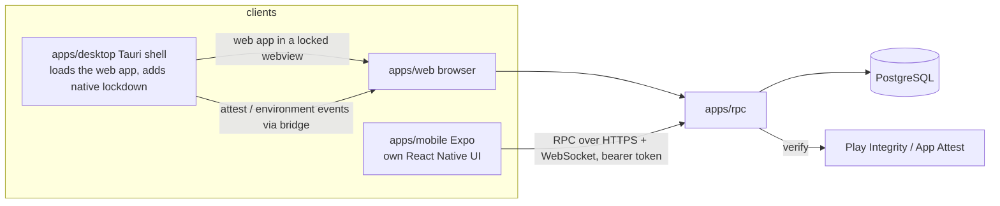
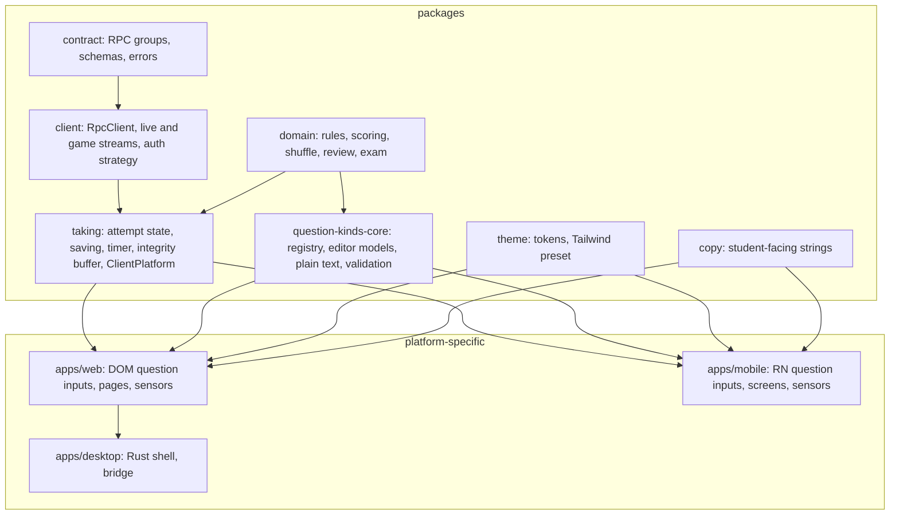
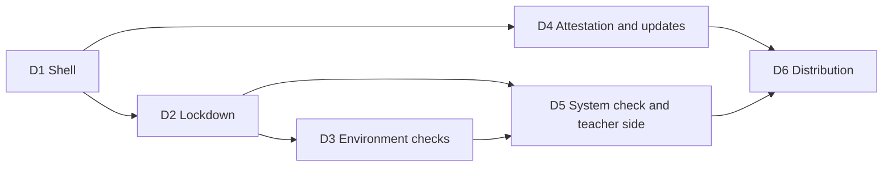
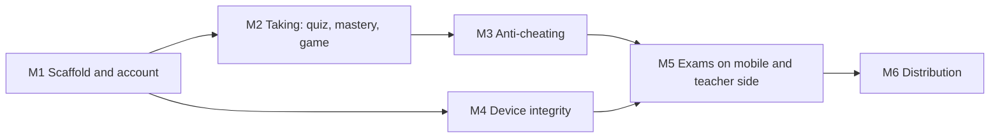
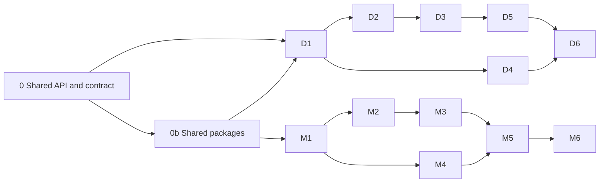

# Native student clients: desktop (Tauri) and mobile (Expo)

Goal: two student-only clients that make exams harder to cheat on than a browser tab can, without changing how
teachers work. The web app stays the teacher's tool and the fallback for students; the API stays the single source
of truth and gains the few operations the native clients need.

## Starting point (verified in source)

- Anti-cheating today is browser-side: `IntegrityEvent { type, at, durationMs? }` (`packages/domain/src/quiz.ts`,
  24 types from `left_page` to `split_screen`) is sent through `attempt.recordEvents`, `attempt.save` and
  `attempt.submit`; `attempt.heartbeat` every 15 s turns gaps over 30 s into `disconnected`.
- "One device per attempt" is a random `deviceId` token kept by the browser (`packages/contract/src/attempt.ts`);
  a different token means `OpenElsewhere`, or `DeviceApprovalRequired` on exams.
- Exam mode refuses phones and tablets from the user agent and client hints (`ComputersOnly`); the locked settings
  are in `examLockedSettings` (`packages/domain/src/exam.ts`).
- `docs/quiz-system-plan.md` §9.8 names what a website cannot do: detect lockdown browsers or virtual machines,
  stop screen capture, see other apps. These are exactly the gaps the native clients close.
- Auth is Better Auth with cookies (`apps/rpc/src/features/auth/BetterAuth.ts`: `admin`, `organization`,
  `anonymous` plugins); browsers only talk to the web app, which forwards `/api/auth/*`. Native clients need
  bearer tokens and must be allowed to call the API directly.
- Live streams use a ticket in the `x-live-ticket` header over WebSocket at `/rpc/live`; this works from any client.
- No automated UI test suite; CI is lint, typecheck, migration drift, seed, smoke test, web build.

## Architecture

Two decisions worth stating up front:

1. **Desktop wraps the web app; it does not reimplement it.** The Tauri shell opens the hosted web app in a locked
   webview and adds what only a native process can do (kiosk mode, process and display checks, capture protection,
   VM detection, signed updates). The taking UI is written once. Tradeoff: the desktop app needs network to show
   anything, which exams require anyway. A standalone UI would mean duplicating `apps/web/src/features/taking`.
2. **Mobile is its own UI.** React Native cannot load Next.js pages natively, and a webview on a phone adds no
   security. The mobile app targets quiz, mastery and game modes first; exams on mobile stay off unless the teacher
   turns on **Allow mobile app** for a session, and then only with a verified device attestation.

Trust model: the API never trusts a client's claim about itself. A client proves what it is (signed attestation
checked on the server), reports what it sees (integrity events, same as today), and the teacher decides (live view,
report). Flags alert; they do not penalise (plan §9.8).

## Reuse across platforms

Three clients share one API, one domain and most of the student flow. The rule: **anything that is not a pixel
or a platform API lives in a package.** Today that is true for rules (`packages/domain`) and schemas
(`packages/contract`) but not for the client-side logic, which sits in `apps/web`
(`src/lib/api/client.ts`, `features/live/client.ts`, `features/exam/components/online-exam/use-*.ts`,
`features/exam/components/exam-integrity.tsx`, `components/question-kinds/*`). Phase 0b extracts it.

What is shared, and what deliberately is not:

| Layer | Shared package | Web | Desktop | Mobile |
|---|---|---|---|---|
| Rules, scoring, shuffling, review, exam locks | `@examinus/domain` (exists) | uses | via web | uses |
| RPC schemas and errors | `@examinus/contract` (exists) | uses | via web | uses |
| RPC client, live/game WebSocket client, reconnect, tickets, auth strategy (`cookie` \| `bearer`) | `@examinus/client` (new, from `apps/web/src/lib/api/client.ts` and `features/live/client.ts`) | cookie | via web | bearer |
| Attempt state machine: answers, saving queue and retries, deadline, time spent, typing log, nav items, mark for review, chances and auto-submit, attempt link guard, integrity event buffer | `@examinus/taking` (new, from `online-exam/use-*.ts`, `typing.ts`, `nav-items.ts`, the pure half of `useIntegrity`) | uses | via web | uses |
| `ClientPlatform` adapter: `kind`, `version`, `deviceId()`, `attest(nonce)`, `sensors` (integrity events in), `lockdown.enter/exit`, `systemCheck()` | interface in `@examinus/taking`; one implementation per client | `WebPlatform` (DOM: `visibilitychange`, fullscreen, `screen.isExtended`, clipboard) | `DesktopPlatform` (in `apps/web`, calls the Tauri bridge; falls back to `WebPlatform` sensors) | `MobilePlatform` (`AppState`, `expo-screen-capture`, Lock Task, Guided Access) |
| Question-kind registry: types, `editor-model.ts`, `plain-text.ts`, validation, answer shapes, sample-test running (`run-js`, `run-python` browser-only; mobile calls the runner) | `@examinus/question-kinds-core` (new, from `components/question-kinds/{types,registry,*/editor-model,shared/plain-text}.ts`) | DOM `input`/`review`/`print`/`editor` per kind | via web | RN `input`/`review` per kind, same `QuestionKind` interface; `print` and `editor` not implemented |
| Design tokens: colours (`danger`, `warning-soft`…), accents, font families, motion durations; radii, spacing and type scale are Tailwind defaults (no tokens) | `@examinus/theme` (new): `tokens.ts` plus a Tailwind preset | Tailwind, CSS-first from `globals.css` (a test keeps it in sync with `tokens.ts`) | via web | NativeWind with the same preset, so class vocabulary matches |
| Student-facing copy: rule labels, integrity event labels (`features/session/integrity.ts`), mode labels, error messages (`DeviceApprovalRequired`, `ComputersOnly`, `ClientOutdated`…), pledge default | `@examinus/copy` (new) | uses | via web | uses |
| Pages, navigation, layout, pixel-level components (`Card`, `Dialog`, `Segmented`, `Watermark`, overlays) | **not shared**: DOM and React Native have no common component model worth a shim | `apps/web` | via web | `apps/mobile` RN equivalents, same names and props where sensible |

Decisions:

- **Hooks over components.** React hooks with no DOM reference (`useAnswerSaving`, `useTimeSpent`, `useAttemptLink`, the
  integrity chances counter) run unchanged in React Native. Components do not. So the boundary is "hook in a package,
  component in the app".
- **Sensors in, events out.** `useIntegrity` today mixes DOM listeners with the counting and auto-submit logic. The
  package keeps the logic and takes an `IntegritySensor` that emits `IntegrityEvent`s; each platform wires its own
  listeners. New native checks (D3, M3) become sensors, not new logic.
- **Same registry shape for question kinds.** Web keeps `QuestionUi<T>` (`Input`, `Review`, `Editor`, `Print`,
  `printTraits`); the shared `EditorModel` registry (`editorModels`) lives in `@examinus/question-kinds-core`. The
  mobile app provides RN `input`/`review` per kind against the same types; a kind missing on mobile renders a "take
  this on a computer" card from `@examinus/copy`, which also drives the API's device check for sessions containing
  such kinds.
- **NativeWind on mobile** so the Tailwind preset from `@examinus/theme` is the single source of design tokens.
  Tradeoff: one more build step on mobile; alternative is a hand-written `StyleSheet` theme that drifts.
- **Desktop reuses everything through the web app.** Its only client code is `DesktopPlatform` inside `apps/web`
  and the Rust shell. No UI framework in `apps/desktop`.
- **No barrels**; each package keeps one entry per module in `exports`, like `domain` and `contract` do today.

## Shared packages (phase 0b)

Extraction only: `apps/web` behaviour is unchanged, verified by taking a quiz, an exam and a game in the browser
after each move.

1. `packages/client`: move `RpcClient` construction, `callApi`, `forwardedHeaders`, the live and game WebSocket
   clients and ticket handling; add `AuthStrategy` (`cookie` for web and desktop, `bearer` for mobile) and a
   `fetch`/`WebSocket` injection point (React Native's globals differ).
2. `packages/taking`: move the hooks and pure helpers named above; define `ClientPlatform`, `IntegritySensor`,
   `SystemCheckResult`; implement `WebPlatform` in `apps/web` and make `useIntegrity` a thin wrapper over the
   package plus `WebPlatform.sensors`.
3. `packages/question-kinds-core`: move the registry types and every `editor-model.ts`, `plain-text.ts` and
   validation; `apps/web` registers its DOM views against it.
4. `packages/theme`: lift the colour tables, accents, font names and motion durations from `globals.css` into
   `tokens.ts` plus a Tailwind v3-style preset; web stays CSS-first and a test pins `globals.css` to the tokens.
5. `packages/copy`: move integrity labels, rule labels, mode labels, student-facing error messages and the default
   pledge; web imports them.
6. CI: `typecheck` and `bun test` cover the new packages; existing domain tests move with their code.

Exit checks: `apps/web` has no import of the moved modules by relative path; the browser flows above work
unchanged; `packages/taking` and `packages/question-kinds-core` have no `document`/`window` reference (lint rule
`no-restricted-globals` in those packages).

What landed:

- **`@examinus/client`**: `rpc.ts` (`makeRpcClient({ url, auth, fetch? })`, `AuthStrategy` = `cookie` | `bearer`) and
  `live.ts` (`makeLiveClient({ requestTicket, WebSocket?, wake? })` with `followTeacher`, `followStudent`,
  `followLobby`, `followGame`). `apps/web/src/lib/api/client.ts` and `features/live/client.ts` are thin wiring.
  `lib/api/helpers.ts` stays in web: it mixes redirects with error mapping.
- **`@examinus/taking`**: answer saving, attempt link (`onWake` injected), `createTimeSpent`, typing log and analysis,
  nav items, `TakeMode`, `ClientPlatform`, and `useIntegrityLog` (an `IntegrityLog` class holds the away-incident
  machine, so it runs without React). Web adds `lib/platform/{web-sensors,web-platform}.ts`; `useIntegrity` wraps the
  package. Web-only: `fullscreenRoot` (`WebTakeMode`) and the IntersectionObserver in `use-time-spent`.
  `isAway` and `awayCount` went to `@examinus/domain/integrity`.
- **`@examinus/question-kinds-core`**: the `EditorModel` registry (`editorModels`, `modelOf`), one `models/<kind>.ts`
  per kind, `plain-text`, `preview-text`, `math`, `code`, `sql`. The shared registry is the **editor model**; the
  views stay web's `QuestionUi<T>` (there is no `QuestionKind` type). `AnswerHeading.icon` is a name
  (`"key" | "rubric" | "tests"`), `newId` uses `globalThis.crypto.randomUUID()`.
- **`@examinus/theme`**: `tokens.ts` (mode colours, accents, fonts, motion, `colorVars`) and `tailwind-preset.ts`
  (colours as the same CSS variables). `tokens.test.ts` fails if `globals.css` and the tokens differ. There is no
  `navy` token (nothing uses it), and radii and spacing stay Tailwind defaults.
- **`@examinus/copy`**: integrity labels and notice strings, mode and status labels, question type labels, and the
  refusal-tag to screen mapping with the take-on-a-computer card text. Server-written messages stay in the API.
- `taking` and `question-kinds-core` have an `eslint.config.mjs` (`no-restricted-globals`) and a `lint` script.

## Shared API and contract work (phase 0)

Needed by both clients; one PR series in `packages/contract`, `packages/domain`, `apps/rpc`.

| Change | Where | Why |
|---|---|---|
| Bearer sessions: Better Auth `bearer` plugin; `expo` plugin with the app scheme in `trustedOrigins`; CORS for the mobile origin | `BetterAuth.ts`, `Session.ts`, server config | Native clients have no cookie jar shared with the web app |
| `Client` schema: `{ kind: "web" \| "desktop" \| "mobile", version, platform }`; `attempt.start` and `attempt.paper` take `client`; stored on `attempts` | contract, domain, migration | Live view and report show which client took the exam |
| `client.attest`: nonce → signed attestation; API verifies (Play Integrity, App Attest, desktop build signature) and issues a short-lived attestation token that `attempt.start` requires when the session demands a native client | contract, `apps/rpc/src/features/attempt` | A browser or a patched app cannot pretend to be the real client |
| Session settings: `requiredClient: "any" \| "desktop"`, `allowMobile: boolean`; exam defaults `desktop` when the school has the desktop app enabled; teacher can only tighten | `packages/domain/src/exam.ts`, session form | Enforced server-side at `attempt.start`, not in the UI |
| Hardware device id replaces the random token for native clients (`deviceId` = machine id on desktop, vendor/Android id on mobile) | `attempt.ts` | "One device per attempt" survives clearing storage |
| New integrity event types: `vm_detected`, `blocked_process`, `screen_capture`, `screen_recording`, `overlay_detected`, `external_display`, `rooted_device`, `emulator`, `kiosk_exited`, `debugger_attached`, `client_outdated` | `integrityEventTypes` | Native checks need names the live view, report and Excel export already know how to count |
| `client.minVersion` in `auth.config`; API refuses `attempt.start` from an older client with `ClientOutdated` | contract | Security fixes reach every student before the next exam |
| Live view and integrity report: client column, environment check results, new event types | `apps/web` | Teachers see it where they already look |

Exit checks: a bearer token signs in and calls `attempt.mine`; a forged attestation is refused; an exam with
`requiredClient: desktop` refuses the browser with a clear message; the report shows the client.

## Desktop app (`apps/desktop`, Tauri 2)

### D1 – Shell (built: `apps/desktop`, README "Desktop app")
Tauri 2 project in `apps/desktop` (Rust core, no front-end framework: the webview loads `EXAMINUS_WEB_URL`, baked in
at build time, overridable at run time). Navigation pinned to the web app's origin; anything else opens in the system
browser; `target="_blank"` and `window.open` are redirected into the window so the same rule applies. One window.
The web app gets no Tauri APIs: it is a remote origin with no capability, so the bridge is one-way for now: a frozen
`window.__EXAMINUS_DESKTOP__ = { version, platform }` plus the `ExaminusDesktop/<version>` user-agent token the API
reads (`clientOf`, `packages/domain/src/client.ts`). `DesktopPlatform` (the `invoke` side of the bridge) arrives
with 0b and D2, when the shell has commands worth exposing; it will need `dangerousRemoteDomainIpcAccess` scoped to
the web origin and the exact commands.
**Version checking** (semantic versioning, GitHub releases as the only channel): the API publishes
`auth.config.api.version` and `desktop.minVersion`; `attempt.paper`/`attempt.start` refuse an older desktop build
with `ClientOutdated`, and the student pages show the update screen. The shell compares its version with the newest
`desktop-v*` release on start-up and offers the download page. Tags `rpc-vX.Y.Z` and `desktop-vX.Y.Z`; README
"Versioning and releases".
Deep link `examinus://session/<id>` deferred to D5 (needs the system check flow).
Exit: sign in, open a session, take a quiz end to end inside the shell on Windows, macOS and Linux.

### D2 – Lockdown
While an attempt is in progress (the web app tells the shell through the bridge): fullscreen kiosk, always on top,
minimise/close/resize refused, devtools and context menu off, every shortcut the OS lets us swallow (Alt+Tab,
Win, Cmd+Tab, Cmd+H, PrintScreen) intercepted and reported as the existing event types (`alt_tab`,
`switched_app`, `exit_fullscreen`, `screenshot`), clipboard cleared at start and kept empty. Released when the
attempt is submitted, the session ends, or the teacher force-submits (student live stream).
Exit: a student cannot leave the window without the event appearing in the live view; the shell releases on submit.

### D3 – Environment checks (Rust)
Run before the attempt and every 10 s during it: running processes against a blocklist (remote desktop, screen
recorders, messaging, other browsers) → `blocked_process`; hypervisor bit, DMI vendor, known VM drivers →
`vm_detected`; display count and virtual displays → `external_display`; capture protection
(`SetWindowDisplayAffinity(WDA_EXCLUDEFROMCAPTURE)` on Windows, `NSWindow.sharingType = .none` on macOS; Linux:
report only) → `screen_capture`/`screen_recording` when the OS exposes it; debugger attached →
`debugger_attached`. Before start, failures block with the exact fix ("Close Discord"); during, they are events.
Exit: each check reproduced on a real machine with the offending app, event and minutes shown in the report.

### D4 – Attestation and updates
Code signing (Authenticode, Apple notarization), `tauri-plugin-updater` with signed updates (today the shell only
offers the GitHub release page; see D1),
`client.attest` implemented: the shell signs the API's nonce with a key embedded at build time plus its build
hash; the API knows the current build hashes and `minVersion`. Honest limit: a determined attacker can extract an
embedded key; the value is raising the bar and binding attestation to a signed, updatable build that can be
rotated. Document this.
Exit: a modified binary fails attestation; an outdated build is told to update before an exam.

### D5 – System check and teacher side
Pre-exam system check screen (displays, processes, VM, capture protection, connection, clock skew) with pass/fail
per item: a web route (`apps/web/src/app/(student)/check`) rendered from `platform.systemCheck()`, so the same screen
serves desktop (bridge results) and, later, the web fallback (browser-only checks). Then the existing rules and pledge.
Session form: **Require desktop app**; live view: client badge and
environment results; report and Excel: the new events.
Exit: a session with the requirement refuses a browser; the teacher sees "Desktop 1.2.0, 2 displays" in the drawer.

### D6 – Distribution
Installers (NSIS/MSI, DMG, deb/AppImage), `.github/workflows/desktop.yml` build matrix on tags, lab deployment
guide (silent install, kiosk user, allowlist), README section, docs page.
Exit: a tagged release produces signed installers; a fresh lab machine installs silently and runs an exam.

## Mobile app (`apps/mobile`, Expo)

### M1 – Scaffold and account
Expo (current SDK, expo-router, TypeScript, NativeWind) in `apps/mobile`; `@examinus/client` with the bearer token
in SecureStore (`AuthStrategy: bearer`); `MobilePlatform` implements `ClientPlatform` from `@examinus/taking`;
Better Auth `expo` client; sign in with email and Google; the
student home: my sessions (`attempt.mine`), results (`attempt.myResult`), standing, attendance (read-only), and
the 7-character join key. Students only: a teacher account is told to use the web app.
Exit: sign in on iOS and Android, see the same session list as the web app.

### M2 – Taking: quiz, mastery, game
Native screens for every question type, each as a `QuestionKind` implementation (`input`, `review`) of the shared
registry in `@examinus/question-kinds-core` (multiple choice, true/false, blank/cloze, enumeration, numeric, matching,
essay, drawing with a canvas, photo, code read-only with Run on the runner, SQL); shuffling and scoring from
`@examinus/domain`; every non-visual piece from `@examinus/taking` (saving queue, time spent, typing log,
navigation items, chances, deadline, attempt link) and `@examinus/client` (RPC, live and game streams). The
screens use the `@examinus/theme` NativeWind preset and `@examinus/copy` strings. Autosave as you type, heartbeat,
server-enforced timer, the student live stream (pause, lock, add time, end), question overview and mark for
review, submit and review. Mastery queue. Game mode: join by code, play teacher-paced and student-paced games and
Team Relay, with the game stream. Answers queued while offline and flushed on reconnect; the server's deadline
still wins.
Exit: a student takes a seeded quiz, a mastery session and a game to the end on both platforms; the teacher's live
view and results match the web.

### M3 – Anti-cheating
`AppState` background/inactive → `switched_app` with duration; `expo-screen-capture`: capture prevented
(`FLAG_SECURE` on Android, protected view on iOS) and screenshot listener → `screenshot`; Android Lock Task mode
(screen pinning through a config plugin, exits → `kiosk_exited`); iOS Guided Access detection with a prompt to
turn it on for exams; split-screen and picture-in-picture detection → `split_screen`; overlay detection
(`filterTouchesWhenObscured`) → `overlay_detected`; clipboard cleared and paste blocked per session settings;
name watermark; one question at a time honoured.
Exit: each rule triggers its event on a device, with minutes in the report.

What landed (M3): the local Expo module `apps/mobile/modules/examinus-integrity` (Kotlin and Swift) reports the pinned
screen, split screen and picture in picture, windows drawn over the exam (`FLAG_WINDOW_IS_OBSCURED` on touches), other
displays and screen recording (Android 15 callback, iOS `isCaptured`), Guided Access. `MobilePlatform.sensors`
(`src/platform/mobile-sensors.ts`) turns them into `IntegritySensor`s for the shared log: `AppState` → `switched_app`
(the log's away state machine adds the time), `expo-screen-capture` listener → `screenshot`, then `split_screen`,
`overlay_detected`, `external_display` (with `blockSecondScreen` it also covers the exam), `screen_recording` and
`kiosk_exited`. `lockdown.enter/exit` (while the attempt is taken and the session requires full screen) prevent screen
capture, pin the screen (`startLockTask`; Guided Access on iOS, asked for before Start) and ask for the pin again when
it is lifted. A pin not confirmed within 15 s counts as `kiosk_exited`. Clipboard cleared at Start
(`clearClipboardOnStart`); `GuardedTextInput` hides the long-press menu per `blockPaste`/`blockCopy`/`blockRightClick`
and refuses or logs text that arrives in one go (more than 30 characters: `paste` with `blockPaste`, else
`bulk_input`); the name watermark tiles over the exam. Limits: Android's pin needs the user's "Screen pinning"
setting on (or a managed device that allows the app); a keyboard's clipboard suggestion shorter than 30 characters
can't be told from typing; overlay detection cannot be triggered from `adb`.

### M4 – Device integrity
`client.attest` on mobile: Play Integrity (Android) and App Attest (iOS) tokens verified by the API; rooted or
jailbroken device → `rooted_device`; emulator → `emulator`; hardware device id as `deviceId`; `minVersion`
enforced with an update screen. Without a valid attestation, exam sessions refuse to start; other modes log it.
Exit: a rooted emulator is refused from an exam and flagged in a quiz.

### M5 – Exams on mobile and teacher side
Session setting **Allow mobile app** (exam mode: off by default, computers-only stays the rule). When on, the
mobile client passes the API's device check, shows the rules, pledge and a system check (Guided Access or Lock
Task on, attestation valid, no overlay, battery), then takes the exam with every locked setting mapped to its
mobile equivalent. Device switch approval and retake flows. Live view and report show "Mobile · Android 15".
Exit: an exam allowed on mobile runs on a pinned device; the same exam refuses an unpinned or rooted one.

What landed (M5): an exam allowed on mobile opens with the gate (`taking/exam-gate.tsx`): system check, honor pledge, rules (`examRulesMobile` in `@examinus/domain/exam`; the web keeps `examRules`), then the usual start page with the room password; Start sends `pledgeAccepted`. `MobilePlatform.systemCheck` (`platform/system-check.ts`) lists attestation (cached `client.attest`), screen pinning (Android `lock_to_app_enabled` through `screenPinningEnabled` in the integrity module, or a pin already on; iOS Guided Access), no external display, no split screen, no overlay seen while the check is open, battery 20% or charging (`expo-battery`) and network; all are required, each failure shows its exact fix, and the check runs again when the app comes back to the front. `SystemCheckResult` items gained an optional `detail`. The pin is released when the attempt is submitted or ended (the result screen is in another navigator, so unmounting is not enough). `DeviceApprovalRequired` waits and continues by itself; the home row says "Retake available" once a retake leaves attempts. Teacher side: `LiveStudent.client`, the "Mobile · Android 15" and "verified" badges in the live row and drawer (`clientBadgeText`), "Mobile app allowed" among the session chips and the form review. Development only: `EXPO_PUBLIC_DEV_ATTESTATION` (an API-signed attestation, read in `lib/attestation.ts` when `__DEV__`) stands in for Play Integrity on an emulator. Android's ANDROID_ID differs per app, so mint the token for the id the app reports, not `adb shell settings get secure android_id`.

### M6 – Distribution
EAS Build profiles, EAS Update with code signing, store metadata, `.github/workflows/mobile.yml`, README and
docs page, school roll-out guide (MDM notes for Lock Task and Guided Access).
Exit: internal track builds install from a link; an OTA update with a bumped `minVersion` rolls out and is enforced.

What landed (M6): `apps/mobile/eas.json` (profiles `development`, `preview`, `production`; submit `production` to the Play
internal track and App Store Connect, IDs from `ASC_APP_ID` and `APPLE_TEAM_ID`), `expo-updates` and `expo-dev-client`,
`app.config.ts` with `runtimeVersion: { policy: "appVersion" }`, `updates.url` from `EAS_PROJECT_ID` (updates are off
when it is unset) and code signing (`certs/certificate.pem`, key id `main`) switched on only when the certificate file
exists; the private key is git-ignored. `.github/workflows/mobile.yml`: pull requests typecheck, lint, bundle both
platforms and resolve the public config; a `mobile-vX.Y.Z` tag is checked against `apps/mobile/package.json` and, with
`EXPO_TOKEN`, starts `eas build --platform all --profile production --no-wait`; a push to `main` publishes
`eas update --channel preview` (signed with the secret `EXPO_UPDATES_PRIVATE_KEY` once the certificate exists). Docs:
README "Mobile app" and `docs/mobile-rollout.md` (internal track install, Screen pinning, Lock Task through MDM, Guided
Access, Autonomous Single App Mode, what teachers turn on, the integrity report).

Honest limits:
- **Nothing was built for iOS here** (the machine is Linux; Xcode is macOS only). The Swift module, the App Attest
  entitlement plugin and the `ios` EAS profiles are written but unrun; `expo export --platform ios` only proves the
  JavaScript bundles. The Android build was run on an emulator only.
- **No EAS build, store submission or OTA update was run**: that needs an Expo account (`EXPO_TOKEN`, `EAS_PROJECT_ID`),
  a Play Console app and an Apple Developer account, none of which exist here. The workflow's EAS steps are untested
  beyond actionlint.
- **`minVersion` and OTA.** The app reports its build's version, and `runtimeVersion` follows it, so an OTA update never
  changes the version the API sees: `MOBILE_MIN_VERSION` retires store builds, not OTA revisions. The exit line "an OTA
  update with a bumped `minVersion`" therefore holds as: ship the JavaScript over the air to builds of the same
  version, and enforce a new store build with `MOBILE_MIN_VERSION`. Enforcing a JavaScript-only revision would need a
  separate revision number in `auth.config`; not built.
- **Play Integrity and App Attest need real credentials** (the app and the API refuse devices without them; exams on
  mobile don't start):

| Variable | Where | How to get it |
|---|---|---|
| `PLAY_INTEGRITY_PACKAGE_NAME` | API | `app.examinus.student` (the Android package in `app.config.ts`). |
| `PLAY_INTEGRITY_SERVICE_ACCOUNT` | API | Google Cloud: create a service account, enable the *Play Integrity API*, make a JSON key, put it on one line. The API decodes tokens with it. |
| `EXPO_PUBLIC_PLAY_INTEGRITY_PROJECT` | app build | The Google Cloud **project number** linked in Play Console → *App integrity* (the app requests tokens for it). Needs the app uploaded to Play (internal track is enough) for tokens to verify as "recognized". |
| `APP_ATTEST_APP_ID` | API | `<Apple team id>.app.examinus.student` (team id from the Apple Developer account's Membership page). |
| `APP_ATTEST_ENV` | API and prebuild | `development` for development-profile builds, empty or `production` for TestFlight and App Store builds; the API's value must match the build's. |
| `EAS_PROJECT_ID` | build, CI variable | `eas init` in `apps/mobile`. |
| `EXPO_TOKEN` | CI secret | Expo account → Access tokens. |
| `EXPO_UPDATES_PRIVATE_KEY` | CI secret | The `private-key.pem` from `npx expo-updates codesigning:generate`. |
| `ASC_APP_ID`, `APPLE_TEAM_ID` | submit environment | App Store Connect → App Information (Apple ID) and Membership. |
| Play service account key | `apps/mobile/certs/play-service-account.json` (git-ignored) | Play Console → API access → service account with release permission. |

## Order

Phases 0 and 0b first (0b can start as soon as 0's contract shapes are agreed); the desktop and mobile tracks are
independent after that. Each phase ends releasable: CI green,
README and `docs/` updated for what changed, exit checks done on real hardware (no emulator-only sign-off for
anti-cheating phases).

## Out of scope

Camera and screen proctoring (plan §8, optional), AI-writing detection, automatic penalties, a teacher UI in
either client, offline exams.
