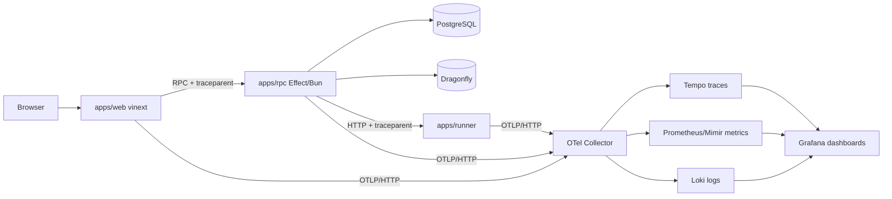

# OpenTelemetry plan

Goal: traces, metrics and logs from the web app, the API and the code runner, exported over OTLP, with Grafana
dashboards checked into the repo. With no OTLP endpoint configured, behaviour stays exactly as today.

## Starting point (verified in source)

- `apps/rpc` already creates spans everywhere: every handler, service and repo method is `Effect.fn("Name")`, and
  `RpcServer` wraps each call in `RpcServer.<rpc>`. They go nowhere: no exporter is installed.
- `apps/rpc/src/platform/RpcCallLog.ts` replaces `Tracer.Tracer` with a wrapper around `Tracer.nativeTracer` to log
  one line per RPC. An OTLP tracer also provides `Tracer.Tracer`, so the two must be composed, not merged.
- `effect@4` ships OTLP exporters in `effect/observability` (`Otlp.layer`, `OtlpTracer`, `OtlpMetrics`,
  `OtlpLogger`). No new dependency is needed for the API.
- `Database.query` / `queryUnique` (`platform/Database.ts`) have no span or timing.
- `apps/web` calls the API through Effect `RpcClient` (`lib/api/client.ts`, `callApi`); Next.js App Router on vinext (Vite).
- `apps/runner/server.mjs` is a plain `node:http` server that shells out to `docker`.

## Architecture

Local and CI backend: one `grafana/otel-lgtm` container (Collector, Tempo, Mimir/Prometheus, Loki, Grafana) under a
`observability` compose profile and a devenv process. Production: any OTLP endpoint; only env vars change.

## Configuration

Standard OTel env vars, read in `AppConfig.ts` (API) and the SDK defaults (web, runner):

| Variable | Default | Effect |
|---|---|---|
| `OTEL_EXPORTER_OTLP_ENDPOINT` | empty | Empty: no exporter, current behaviour. Set: export traces, metrics, logs. |
| `OTEL_SERVICE_NAME` | `examinus-api` / `examinus-web` / `examinus-runner` | `service.name` resource |
| `OTEL_RESOURCE_ATTRIBUTES` | empty | e.g. `deployment.environment=prod` |
| `OTEL_TRACES_SAMPLER_ARG` | `1` | Head sampling ratio for production |

Document them in `apps/rpc/.env.example`, `apps/web/.env.example` and README.

## Phase 1: API traces and logs export

1. `platform/Observability.ts`: when the endpoint is set, add `Otlp.layer({ baseUrl, resource: { serviceName,
   serviceVersion, attributes } })` from `effect/observability` (needs an `HttpClient` layer, e.g.
   `FetchHttpClient.layer`).
2. `RpcCallLog.ts`: wrap whatever tracer is current (the OTLP one when enabled, `nativeTracer` otherwise) instead of
   hard-coding `Tracer.nativeTracer`. Keeps the per-RPC log line and exports the span.
3. Annotate `RpcServer.*` spans with `rpc.outcome` (reuse `outcome()`), `enduser.role`. No user ids, emails or
   answer contents in attributes.
4. `Database.query`/`queryUnique`: wrap in `Effect.withSpan("db.query", { kind: "client", attributes:
   { "db.system": "postgresql" } })`. Do not record SQL parameters.
5. Logs: keep the console logger; add `OtlpLogger` so logs carry `trace_id`/`span_id` and link from Tempo to Loki.

Check: with the LGTM container up, one `attempt.start` shows a single trace: `RpcServer.attempt.start` →
`Taking.start` → `AttemptRepo.*` → `db.query`.

## Phase 2: API metrics

Effect `Metric` instruments, exported by `OtlpMetrics`. Labels are low-cardinality only (rpc name, outcome, type,
provider); never session, attempt or user ids.

| Metric | Type | Labels | Recorded in |
|---|---|---|---|
| `rpc.server.duration` (ms) | histogram | `rpc`, `outcome` | `RpcCallLog.ts` span end hook (already has name, outcome, duration) |
| `db.client.duration` (ms) | histogram | `op` (`query`/`unique`), `outcome` | `Database.ts` |
| `live.connections` | gauge (up/down) | `kind` (session/game) | live WebSocket route |
| `live.rooms.active` | gauge | `mode` | game rooms / live hub |
| `attempt.events` | counter | `event` (start, save, submit, heartbeat, autosubmit) | `Taking.ts`, `Saving.ts` |
| `integrity.events` | counter | `type` (tab_switch, paste, device_change, ...) | `AttemptRepo.addEvent(s)` callers |
| `runner.duration` (ms) | histogram | `language`, `outcome` (pass/fail/timeout/unavailable) | `Runner.runTests` |
| `ai.calls` / `ai.duration` | counter / histogram | `provider`, `model`, `kind`, `outcome` | `Ai.callModel` |
| `ratelimit.rejected` | counter | `limit` | `RateLimiter` |
| `cache.requests` | counter | `result` (hit/miss) | `Cache.ts` |
| `asset.uploads` | counter | `purpose`, `outcome` | `Assets.confirm` |
| runtime | gauges | — | event-loop lag, heap used, fiber count, sampled every 10 s |

## Phase 3: web app and trace propagation

1. `apps/web/src/instrumentation.ts` with `registerOTel` (`@vercel/otel`) or `@opentelemetry/sdk-node`; read
   `node_modules/next/dist/docs/` on instrumentation first, as the repo rules require for Next 16.
2. Make `callApi` run inside the active OTel span and send `traceparent` with the RPC request (add it next to
   `forwardedHeaders`). Confirm the API's HTTP server continues the incoming trace; if not, extract `traceparent` in
   the API middleware and set it as the parent span.
3. Server-side only. Browser RUM is out of scope.

Check: a page load in the web app produces one trace spanning `examinus-web` and `examinus-api`.

## Phase 4: code runner

1. `@opentelemetry/sdk-node` + `@opentelemetry/instrumentation-http` in `apps/runner/server.mjs`, loaded only when
   the endpoint is set.
2. One span per job with child span `docker run`; attributes `language`, `exit_code`, `timed_out`.
3. Metrics: `runner.jobs` (counter, by outcome), `runner.queue.depth` (gauge), `runner.container.duration` (histogram).
4. API `Runner.ts` forwards `traceparent`.

## Phase 5: dashboards and alerts

Grafana JSON provisioned from `observability/grafana/dashboards/`, datasource config in
`observability/grafana/provisioning/`, mounted into the LGTM container.

**API overview**
- Requests/s by RPC (stacked)
- Error rate % by `outcome` (Forbidden, NotFound, Conflict, defect, interrupted)
- p50 / p95 / p99 latency, overall and per RPC
- Top 10 slowest RPCs (table, p95)
- DB query p95 and queries per RPC call
- Rate-limit rejections by limit
- Cache hit ratio
- Event-loop lag, heap, fibers

**Exams and live sessions**
- Active live connections and game rooms
- Attempts started vs submitted per minute
- Autosaves and heartbeats per minute (spikes = load; drops = clients disconnected)
- Integrity events by type (stacked), the anti-cheating signal during an exam
- Auto-submits at deadline

**Code runner and AI**
- Runner jobs/min by outcome, p95 duration, queue depth
- AI calls by provider/model, p95 latency, failure rate

**Traces** (Tempo panels)
- Slowest traces in the window, linked to logs in Loki
- Error traces filtered by `rpc.outcome = defect`

Alerts (Grafana alert rules, also in the repo):

| Alert | Condition |
|---|---|
| API defects | `defect` outcome > 0 for 5 min |
| API latency | p95 `rpc.server.duration` > 1 s for 10 min |
| Save failures during an exam | `attempt.saveAnswer` error rate > 2 % for 5 min |
| Runner unavailable | `runner.duration{outcome="unavailable"}` > 0 for 5 min |
| Event-loop lag | > 200 ms for 5 min |

## Phase 6: docs and verification

- README and `apps/rpc/.env.example`: how to start the stack (`docker compose --profile observability up`), env vars,
  Grafana URL.
- Smoke test: start LGTM, API, web, runner; sign in, start an attempt, save, submit, run a code question; confirm in
  Grafana one connected trace web → api → db → runner, all dashboard panels populated, logs linked from traces.
- Disabled path: run the existing CI smoke test with no `OTEL_EXPORTER_OTLP_ENDPOINT`; output and per-RPC log lines
  unchanged.

## Risks

- **Tracer conflict:** `RpcCallLog` and the OTLP tracer both provide `Tracer.Tracer`; Phase 1 step 2 resolves it.
- **Cardinality:** ids in metric labels would blow up Prometheus; enforced by the label list above.
- **Privacy:** spans must not carry answers, emails, AI prompts or SQL parameters (student data).
- **Overhead:** `attempt.heartbeat` and `saveAnswer` are high-volume; use ratio sampling in production and keep
  metrics (not traces) as the source for rate panels.
- **Multiple API instances:** gauges (`live.connections`, rooms) are per instance; dashboards sum by
  `service.instance.id`.
