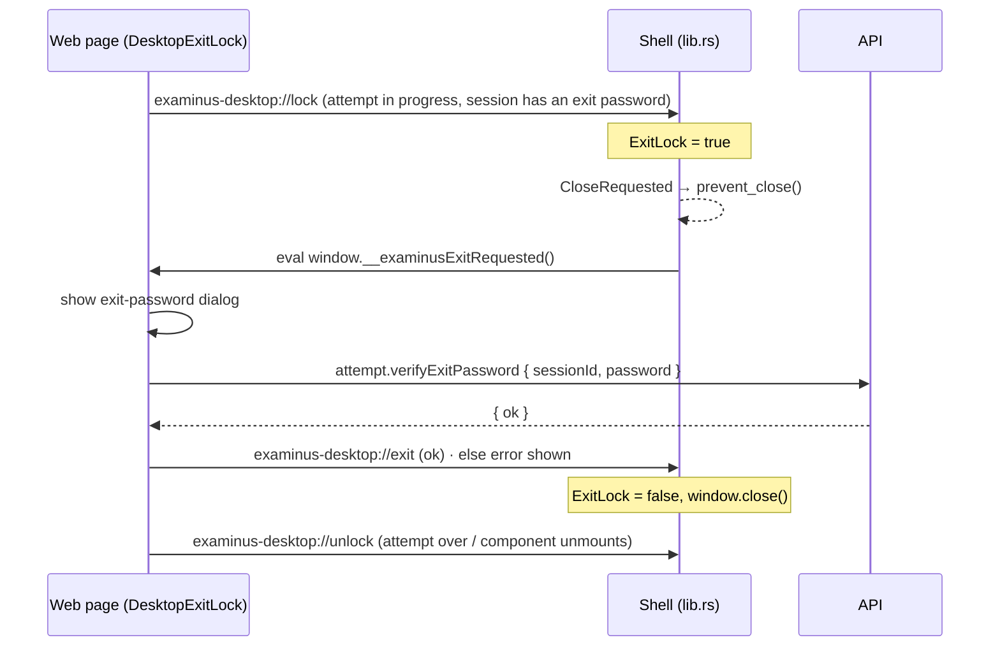

# Desktop app (Examinus Desktop)

`apps/desktop` is the student client for exams: one Tauri 2 window (Rust, no front-end framework of its own) that shows the hosted web app and adds what a browser tab can't. The web app gets **no Tauri APIs** — it is a remote origin with no capability; the shell's own capability covers only its connecting page. Phases beyond the shell are planned in `docs/native-clients-plan.md`.

## What the shell is

- **Where it points.** `EXAMINUS_WEB_URL` is baked in at build time (`option_env!`) and can be overridden by the same environment variable at run time; it must be `http(s)` with a host. The window opens the web app's `/desktop` start page (sign in or join with a key), never the landing page. `EXAMINUS_RELEASES_REPO` (default `ejluv143/ExamSIC`) names the GitHub repository whose `desktop-vX.Y.Z` releases carry the installers.
- **It says what it is.** The user agent is a desktop browser string for the platform with `ExaminusDesktop/<version>` appended (it must read as a computer, because computers-only exams refuse phones by user agent), and an initialization script freezes `window.__EXAMINUS_DESKTOP__ = { version, platform }` before any page script runs. The web app reads the global through `lib/desktop.ts#desktopBridge`; the API reads the user agent through `@examinus/domain/client#clientOf` (anything without the token is `web`).
- **Navigation stays inside.** `on_navigation` allows the web app's origin and the shell's own page; an `examinus-desktop://` URL is a signal (below) and is swallowed; any other `http(s)` URL (a link in a question, the release page) opens in the system browser while the window stays put. `window.open` and `target="_blank"` links are rewritten to navigate the same window so this policy applies to them.
- **Connecting page.** The shell `HEAD`s the web app with a 10 s timeout and only navigates when it answers; otherwise its own page says "Can't reach …" with a Try again button backed by the single `retry` command.

## Two version checks

| Check | Where | Effect |
|---|---|---|
| GitHub releases | `updates.rs` at start-up: newest non-draft, non-prerelease release tagged `desktop-v…`, compared as semver | A dialog offers the release page when it is newer. Installs aren't automatic (no update signing key yet). A failed check is logged and skipped. |
| API minimum | `DESKTOP_MIN_VERSION` on the API; `outdatedClient` in `features/exam/rules.ts` compares the user agent's version | `attempt.paper` and `attempt.start` fail with `ClientOutdated` (message, version, minVersion, releasesUrl); the web app shows "Update Examinus Desktop" with the link. Browsers always pass. Raise it after a security fix so every lab machine updates before the next exam. |

Versions: `apps/desktop/package.json` and `src-tauri/Cargo.toml` must agree (CI checks), tags are `desktop-vX.Y.Z`, separate from the API's `rpc-v…` series. See [Development and CI](../operations/development-and-ci.md).

## Web browser or desktop app, per session

`integrity.allowedClients` (missing: both) lets a teacher restrict a session to the desktop app or to browsers ("Where it can be taken" in the Anti-cheating step). `wrongClient` refuses `attempt.paper`/`attempt.start` from the other kind with `Forbidden`; when the desktop app is required the message carries the releases page so the student knows where to get it. `session.create`/`update` refuse an empty list. See [Exam mode and anti-cheating](../modes/exam-mode-and-integrity.md).

## The signal channel and the exit password

The page cannot call into the shell, so it signals by **navigating to `examinus-desktop://<name>`**, which `on_navigation` intercepts, acts on and cancels:

- `ExitLock` is an atomic flag owned by the shell: `lock` sets it, `unlock` clears it, `exit` clears it and closes the window. While set, every close request (title bar, Alt+F4, Cmd+Q) is refused and the page is asked to show its dialog.
- `DesktopExitLock` mounts in the student's exam page only while an attempt is in progress, the session has an exit password (`Session.exitPasswordRequired`) and the bridge global exists; in a browser it renders nothing.
- `attempt.verifyExitPassword` (API, `Taking.verifyExitPassword`) answers `ok: true` when the session has no exit password or the student has no attempt in progress, compares the trimmed password otherwise, and counts wrong tries per attempt (10 per 10 minutes, then `Forbidden`). The password itself is stored in `quiz_sessions.exit_password` and only ever sent to the teacher (`session.get`).

The channel was verified against the web side with a faked bridge; the custom-scheme navigation path should be confirmed on real WebKitGTK and WebView2 builds before a release that relies on it.

## Building and running

`EXAMINUS_WEB_URL=http://localhost:3000 npm run dev:desktop` (Tauri prerequisites: Rust and, on Linux, webkit2gtk 4.1) runs it against the local web app; `npm run build:desktop` makes installers for the current OS. `.github/workflows/desktop.yml` runs `cargo fmt --check` and `cargo clippy -D warnings` when `apps/desktop` changes and publishes installers on a `desktop-v*` tag.
