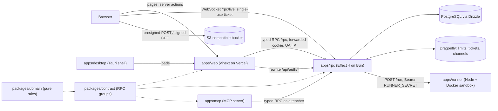

# System architecture overview

Examinus is a quiz and exam platform for colleges: reusable quizzes, sessions in four modes (quiz, exam, mastery, game) that all gather students in a lobby before they start, live monitoring and anti-cheating, grading, classes, attendance and class records. Accounts belong to **organizations** with membership roles (owner, admin, teacher, student); the platform role `admin` is global, and **guests** are anonymous accounts that can only play games whose teacher allowed guests. The code name **examora** survives in the database, cookies and the sandbox image.

## Components

| Part | Role | Page |
|---|---|---|
| `apps/web` | The UI for `/admin`, `/teacher`, `/student`, `/organizations`, the guest areas `/join` and `/play`, `/desktop` and marketing pages. Server code calls the API; the browser never calls `/rpc` itself. | [Web app](./web-app.md) |
| `apps/rpc` | The only owner of PostgreSQL, Dragonfly, Better Auth, S3 and runner credentials. Serves `/rpc`, `/rpc/live`, `/api/auth/*`, `/health`; runs background jobs. | [API server](./api-server.md) |
| `packages/domain` | Pure rules and schemas shared everywhere: the question-kind registry, scoring, shuffling, integrity analysis, game points, roles and permissions. | [RPC contract and domain](./rpc-contract.md) |
| `packages/contract` | Effect `RpcGroup`s, request/response schemas, tagged errors and middleware. | [RPC contract and domain](./rpc-contract.md) |
| `apps/runner` | Grades code answers in one throwaway Docker container per submission. Optional. | [Code runner](../integrations/code-runner-and-sql-grader.md) |
| `apps/desktop` | Examinus Desktop: a Tauri window around the web app for exams, with version checks and an exit-password lock. | [Desktop app](./desktop-app.md) |
| `apps/mcp` | An MCP server that lets an AI client act as a signed-in teacher: create questions, analyse sessions, report on students. | [MCP server](../integrations/mcp-server.md) |
| PostgreSQL / Dragonfly / S3 | Persistent state; counts, tickets and event channels; question images and drawings. | [Database schema](../data/database-schema.md), [Asset storage](../integrations/asset-storage.md) |

## Request flow (server-rendered page or server action)

1. The browser requests a page. `apps/web/src/proxy.ts` resolves the session through the API, sends anonymous users to `/login?next=…`, users in another role's area to their own home (`homeFor`), signed-in users on `/login` home, and copies refreshed session cookies to the response. It is routing only; every data call is authorised again.
2. Server code in `apps/web/src/features/<feature>/data.ts` calls `callApi((api) => api["group.name"](payload), forwardedHeaders(headers))` from `lib/api/client.ts`. Only `cookie`, `user-agent`, `x-forwarded-for` and the `sec-ch-ua-*` hints are forwarded, so the API sees the browser's session, IP, device and client (browser or desktop app).
3. The API decodes the request against the contract schema, the auth middleware resolves the Better Auth session and active organization, and the handler checks `requirePermission` before calling a service.
4. Declared errors (`Forbidden`, `NotFound`, `Conflict`, …) come back as the failure side of a `Result`; transport failures (`RpcClientError`) and defects throw in the web app.

Sign-in also goes through RPC, returning cookies the web app sets with `applyCookies`. Only the Google OAuth callback is browser-driven: the web app rewrites `/api/auth/*` to the API, whose `BETTER_AUTH_URL` is the web app's origin. See [Authentication](../security/auth-and-permissions.md).

## Live updates

Browsers cannot send the web app's login cookie to the API's host, so live views never authenticate with cookies. The web server asks the API for a short-lived single-use ticket (`live.ticket`) and gives the browser the WebSocket URL, derived at request time from `PUBLIC_API_URL` (else `API_URL`). The browser opens `ws(s)://<api>/rpc/live` and streams teacher, student, lobby or game views. Every stream is rebuilt from PostgreSQL on connect; deltas travel over Dragonfly channels, so a reconnecting browser or a restarted API shows the same state. See [Live sessions](../modes/live-sessions.md).

## Where state lives

| State | Store | Notes |
|---|---|---|
| Accounts, organizations, classes, quizzes, sessions, attempts, answers, integrity data | PostgreSQL | The single source of truth; every read derives session status from the clock. |
| Rate-limit counts, redeemed live tickets, presence, short caches, live/game channels | Dragonfly | Required; shared across API instances and restarts. |
| Question images, drawings | S3-compatible bucket | Private; presigned uploads and signed reads. |
| Game rooms (players, clocks, tallies) | API process memory | A working copy of PostgreSQL rebuilt on restart — the reason one API instance is still assumed. |

## Grading paths

Scoring is pure code in `packages/domain/scoring.ts` and the question kinds. On submit the API grades objective questions itself, sends code to the runner (`Runner.runTests` answers `null` when the runner is unconfigured, unreachable or refuses the job, so the answer waits for the teacher), and runs SQL with sql.js in a separate killable process. See [Grading](../workflows/grading-and-results.md).

## Deployment assumptions

- Web on Vercel; API in a container that keeps WebSockets open (the Dockerfile targets Cloud Run's `$PORT`); the API binds loopback by default because only the web app should call it.
- `BETTER_AUTH_URL` and `LIVE_ALLOWED_ORIGINS` on the API must name the web app's real origin, or sign-in callbacks and live sockets are refused.
- Environment variables per app: [Development and CI](../operations/development-and-ci.md).
