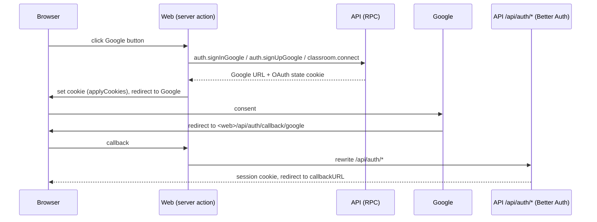

# Google sign-in and Classroom import

Both features share one Google Cloud OAuth client.

## Requirements

| Where | What |
|---|---|
| Google Cloud | A project with the **Google Classroom API** enabled (sign-in alone doesn't need it); an OAuth consent screen (in Testing, every user must be a test user; the Classroom scopes are *sensitive*, so a public launch needs verification); an OAuth client of type **Web application** whose authorized redirect URI is `<BETTER_AUTH_URL>/api/auth/callback/google`. |
| API (`apps/rpc/.env`) | `GOOGLE_CLIENT_ID` and `GOOGLE_CLIENT_SECRET` — **both or neither**, the API refuses to start with one. `BETTER_AUTH_URL` is the **web app's** origin (the web app rewrites `/api/auth/*` to the API), and `BETTER_AUTH_SECRET` must be at least 32 characters. |
| Tests only | `CLASSROOM_API_URL` and `GOOGLE_TOKEN_URL` override Google's endpoints; `npm run check:classroom` (`src/checks/classroom-sync.ts`) runs the sync against a stand-in. |

Without the Google pair, `auth.config` reports `google: false`, the Google buttons are disabled and Classroom RPCs answer `ClassroomUnavailable`.

## OAuth round trip

The browser never talks to the API directly, so the RPCs return Better Auth's state cookie with the URL and the web action sets it before redirecting. Redirect starts are rate-limited per IP (`limits.google`, 300 per 10 minutes).

## Sign-in and sign-up (`features/auth`)

- `auth.signInGoogle` signs in **existing** accounts only: Google is configured with `disableImplicitSignUp`, and email/password sign-up through Better Auth is disabled too.
- `auth.signUpGoogle` (from `/register`, after the terms) passes `requestSignUp` and the chosen profile (teacher or student) as OAuth `additionalData`. A `user.create.before` hook reads it back from the OAuth state, re-validates it (it is client-supplied), sets the platform role and `termsAcceptedAt`, and rejects the creation when the profile is invalid; a teacher gets an organization of their own. Guests from `auth.joinAsGuest` go through the same hook and get the `guest` role without Google.
- Account linking trusts Google and allows **different emails**, so a teacher who signed in with one address can link the school Google account for Classroom.

## Connecting Classroom (`features/classes/Classroom.ts`)

`classroom.connect` (teachers, `class: create`) calls Better Auth's `linkSocialAccount` with the three read-only scopes from `packages/domain/classroom.ts` — `classroom.courses.readonly`, `classroom.rosters.readonly`, `classroom.profile.emails` — plus `access_type=offline`, `prompt=consent`, `include_granted_scopes=true` so Google returns a refresh token. Tokens live in Better Auth's `accounts` table; `classroom.status` reports `connected` when a linked Google account's scope string contains all three.

**Access tokens** are reused while valid for more than a minute; otherwise the stored refresh token is exchanged at `GOOGLE_TOKEN_URL` and the new token written back. No refresh token, a failed refresh or a 401 from Classroom means "Google access ended. Connect Google Classroom again."; other failures map to `ClassroomUnavailable` messages.

## Importing and syncing

- `classroom.courses`: every page (100 per page) of the teacher's **ACTIVE** courses, each annotated with the Examinus class id if already imported.
- `classroom.import` (`class: create` + `roster: update`): for each course not yet imported, creates a class with a fresh join code, `courseCode` = the first word of the course name (Classroom has none), fields truncated to column limits, and a `classroom` link `{ courseId, link, lastSyncedAt }`, then syncs its roster. Already-imported courses return their existing class.
- `classroom.sync`: re-reads the course's students and **adds** newcomers; nobody is removed. Updates `lastSyncedAt`.

`syncRoster` per student: skip those without an email; reuse a roster entry with the same email (case-insensitive) or create one with no account, student number or sex; insert the membership; and when the entry already has an account, add that student to the class's not-ended sessions.

## Claiming imported entries

A student who later signs in and uses enrollment claims an unowned entry with the same email **only if their email is verified** — true for Google sign-ins, false for email/password sign-ups — so nobody takes over a classmate's grades by registering with their address. They still supply a student number and sex on their next class join. See [Classes, attendance and the class record](../concepts/classes-attendance-and-class-record.md).

## Web side

`features/classes/actions.ts`: `connectClassroomAction` sets the state cookie and redirects to Google (errors return to `/teacher/classes?classroom=<message>`); import and sync actions revalidate and redirect to the class.
