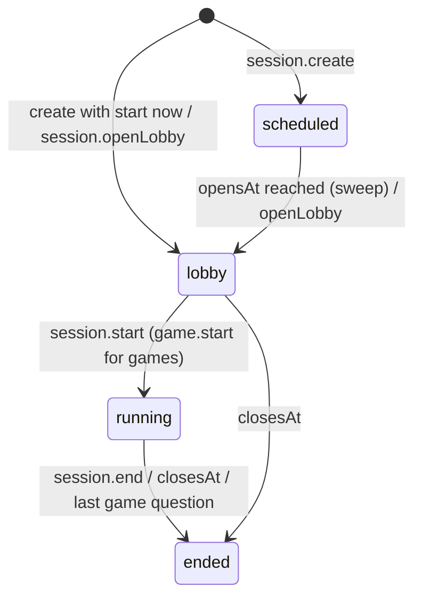

# Session and attempt lifecycle

A **session** runs one quiz for a class (or for whoever has the key) in a mode — `quiz`, `exam`, `mastery`, `game`. Every mode goes through the same states:

## Creating and editing (`features/session/Lifecycle.ts`, `settings.ts`)

- `settingsColumns` validates before saving: a per-question time limit or non-free navigation needs one question at a time; `maxMarked` must be 0–500; game settings (`gameSettingsProblem`) and exam locked settings (`examSettingsProblem`) must hold; IP allowlist entries must be addresses or CIDR ranges; only games may allow guests.
- `session.create` draws a **join key** (`packages/domain/join-key.ts`) and retries up to 20 times on a collision with the partial unique index (keys are unique among sessions that haven't ended), then snapshots the class's account-holding members into `session_students`. **Start now** puts every mode in the **lobby** (`status: lobby`, `opensAt: now`); a game's lobby lives in its room (see [Game mode](../modes/game-mode.md)).
- `session.update` before the session opens may change anything; once it has opened it keeps the stored mode, pacing, class, opening time, paper rules, anti-cheat, exam and mastery settings while the schedule end, limits, attempts, results, late join, passwords, networks, guests and game clock may change. A running game then reloads its settings (`game.applySettings`); a relay's settings freeze once it starts.

## Status and the lobby

`rules.ts#sessionStatus` derives status on every read from the stored status, `opensAt`, `closesAt` and a clock frozen at `pausedAt`: past `closesAt` is `ended`; a `scheduled` session past `opensAt` is `lobby`; it is `running` **only** once the teacher pressed Start. The minute **sweep** (`features/session/Service.ts`) persists those transitions (`repo.advance`: scheduled→lobby, →ended at `closesAt`), tells live watchers, and auto-submits attempts still in progress past their deadline plus the 60 s grace (`time_up`).

In the **lobby** students who open the session are recorded as joined (`session_students.joined_at`, `repo.markJoined`) and the teacher sees who is in; the student's page (`features/attempt/components/session-lobby.tsx`) follows the `live.lobby` stream and refreshes on its own, and moves to the intro the moment the teacher starts. `session.openLobby` opens it early; `session.start` refuses (`Conflict` "Open the lobby first.") unless the lobby is open; `session.end` ends the session and auto-submits every in-progress attempt (`session_ended`).

## Starting and resuming an attempt (`features/attempt/Taking.ts`)

`attempt.start { sessionId, deviceId, roomPassword?, pledgeAccepted? }` checks, in order: the session is `running` ("Wait in the lobby" while it isn't), the student is on the roster and not removed, attempts are left (with granted retakes), the exam pledge, the late-join cutoff, the room password, the IP allowlist, and the client rules (desktop version, allowed clients, phones on computers-only exams) — details in [Exam mode](../modes/exam-mode-and-integrity.md). The attempt stores a paper **seed**, the device token, IP and `last_seen_at`. An existing in-progress attempt is resumed instead.

The **device token** is a random id in the `examinus_device` cookie (`apps/web/src/lib/device.ts`), sent with every attempt call; clearing cookies mid-exam locks the student out until the teacher allows them back in. Every call on the attempt goes through `AttemptService.guard` (device, grace period, network).

## The paper, navigation and marks

- `attempt.paper` returns the student's seeded paper (`orderForAttempt`), saved answers and typing state; mastery sends nothing (see [Mastery](../modes/mastery-mode.md)) and games go through `game.*`.
- **One question at a time**: only the current question is sent; `questionProgress` moves the student on when a question's time runs out (even while away) and timed-out questions are recorded as used up so they never reopen; `saveAnswer` accepts the current question only within its time plus a 3 s grace (`questionGraceMs`).
- **Navigation** (`packages/domain/review.ts#moveRefusal`): `free` goes anywhere; `forward_only` only on to the next question once this one is answered or timed out; `marked_only` goes on the same way and back only to marked questions or the furthest reached. Exams default to `marked_only` with 5 marks; other modes to `free` with unlimited marks.
- `attempt.setMarked` enforces the mark limit under a row lock on the attempt so concurrent marks can't exceed it; with one question at a time only the current question can be marked.

## Autosave, events and deadlines

The exam page (`features/exam/components/online-exam/`) autosaves each answer about **800 ms** after a change and retries failed saves after **5 s**, flushes integrity events after **1 s**, and sends a heartbeat every **15 s**. An attempt's **deadline** is the earlier of its time limit from start and the session close, plus the attempt's extra time (`attemptDeadline`); pauses shift it (see [Live sessions](../modes/live-sessions.md)).

## Submitting

Paths: the student's Submit (the review screen lists unanswered and marked questions via `answerSummary`), auto-submit by the integrity hook after too many leaves, the teacher's force submit, `session.end`, and the sweep's `time_up`. `attempt.submit` is guarded like any call but skips the IP allowlist check so a student who changed networks can still hand in. Grading is in [Grading and results](grading-and-results.md).
